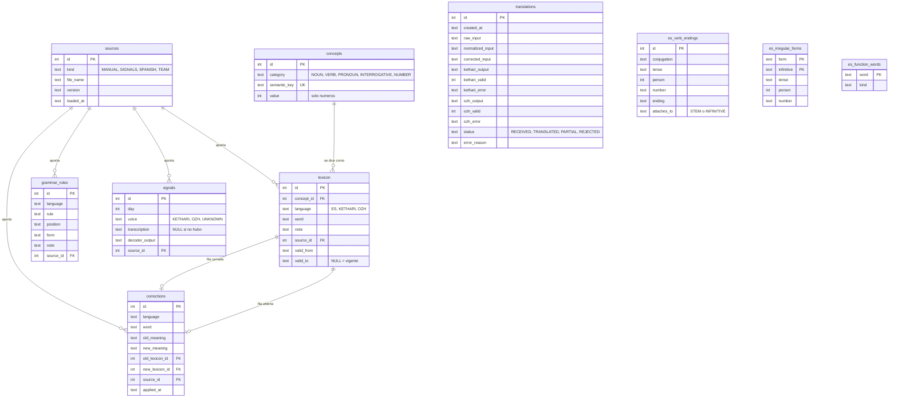

# Modelo de datos

El esquema esta en `src/db/schema.sql`. El programa lo crea al abrir la base si no existe.

## Diagrama entidad-relacion

## Justificacion

**Concepto en el centro.** Una palabra no se traduce a otra palabra sino a un significado. `concepts` guarda el significado y `lexicon` dice como se expresa en cada lengua. Asi caben los casos del manual: un concepto con varias palabras (`anul` y `anir` para NOSOTROS, "venir" y "llegar" para VENIR), y una palabra en varios conceptos (el posesivo "su").

**Vigencia en vez de borrado.** Axios exige responder que se creia en un momento que significaba cada palabra. Por eso una correccion no modifica ni borra filas: cierra la fila vieja con `valid_to` y abre una nueva con `valid_from` en el mismo instante. El significado de una palabra en el momento `t` es la fila con `valid_from <= t < valid_to`. Para saber que se creia cuando se envio una traduccion basta con usar su `created_at` como `t`.

**Cada dato con su fuente.** La condicion 3 ("no se inventa nada") pide que cada palabra este respaldada por el manual o por una señal. `sources` registra cada archivo cargado (con la version del manual que anuncia su cabecera) y cada fila del lexico y de las reglas apunta a la suya. Las reglas que el equipo dedujo y no estan en el manual (base 6 de Kethari) tienen su propia fuente de tipo `TEAM`, para que nunca se confundan con el manual.

**Reglas en datos, no en codigo.** El enunciado prohibe escribir el lexico o las reglas en el codigo. `grammar_rules` guarda afijos, particulas, orden de palabras y base numerica de Kethari y Ozh; las tablas `es_*` guardan desinencias, formas irregulares y palabras gramaticales del español.

**Ninguna pregunta se pierde.** `traducir` inserta la pregunta en `translations` con estado `RECEIVED` antes de procesarla y la actualiza al terminar. Si algo falla a mitad, la pregunta ya esta guardada. Cada lengua tiene su propia salida, validez y motivo, porque una puede salir bien y la otra no (`PARTIAL`).

**Cargas atomicas e idempotentes.** Un archivo se carga en una sola transaccion: si una linea esta mal no queda nada a medias, y el error dice en que linea. Cargar el mismo archivo dos veces no duplica nada (indices unicos en señales y en el lexico vigente), y recargar el manual viejo no revive una palabra que ya fue corregida.

**Señal desconocida.** La señal del dia 6 sin transcripcion ("Ya los escuchamos") se guarda con `voice = 'UNKNOWN'` y `transcription = NULL`. Queda en el registro, pero no aporta ninguna palabra al lexico.

## Cambios respecto a la propuesta inicial del equipo

| Propuesta inicial | Problema | Cambio |
|---|---|---|
| `lexicon` sin fuente | No se puede demostrar que una palabra viene del manual o de una señal (condicion 3) | Tabla `sources` y `lexicon.source_id` |
| `signals.raw_transcription NOT NULL` | La señal del dia 6 no tiene transcripcion | Columna opcional y voz `UNKNOWN` |
| `signals` sin restriccion unica | Cargar dos veces el archivo duplica las señales | Indice unico por dia, voz y transcripcion |
| `morphology_rules` solo con `PREFIX` y `SUFFIX` | Ozh usa palabras sueltas (`ʔoka`, `ne`, `zi`), y no caben orden SOV/VSO ni base numerica | `grammar_rules` con mas posiciones y reglas sin posicion |
| Desinencias del español en la misma tabla que los afijos alienigenas | Necesitan conjugacion (-ar/-er/-ir) y saber si van sobre la raiz o el infinitivo | `es_verb_endings` y `es_irregular_forms` aparte |
| `grammatical_meta` con `{"inclusive": true}` | El manual dice que no se sabe si anul y anir son distintos; marcarlo seria inventar | Columna `note` con el texto del manual |
| `translation_history` con un solo `error_reason` | No dice cual de las dos lenguas fallo | Validez y motivo por lengua, y `status` |
| No habia registro de correcciones | No se sabe que archivo cambio que palabra | Tabla `corrections` |
| Columnas sin `CHECK` | Se podia guardar `language = 'kethary'` | `CHECK` en lenguas, categorias y estados |
